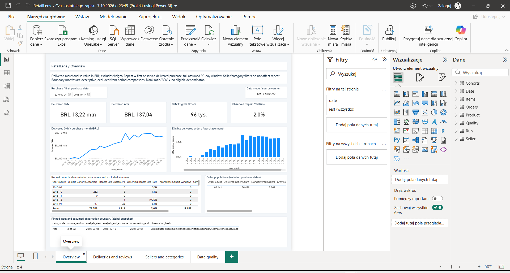

# RetailLens — marketplace analytics

A marketplace analyst needs to compare sales value, delivery outcomes and repeat
purchases without multiplying money through joins or hiding incomplete observations.
RetailLens turns official Olist CSVs into PostgreSQL marts and a four-page Power BI
report with explicit KPI populations, exclusions and traceable SQL results.

*Actual Power BI Desktop capture: **real / Olist v2**, 2016-09-04–2018-10-17,
accepted RL-08 endpoint-refresh run. [Image provenance and data attribution](docs/images/README.md).*

## Three results from the executed real study

- **Review scores: 4.29 for on-time vs 2.27 for late deliveries**, with 88,101 and
  6,357 observed reviews. Counts and coverage accompany the means; this is
  association, not causation. [SQL](sql/05_deliveries_reviews.sql) ·
  [Exact grouped results](docs/evidence/real/sql_evidence.json).
- **299 delivered orders exceed the 0.01 BRL reconciliation tolerance**; 96,178
  match and one is not comparable. The mismatched group's paid-minus-expected
  total is +2,832.14 BRL, requiring investigation rather than a loss claim.
  [SQL](sql/07_reconciliation.sql) · [Results](docs/evidence/real/07_reconciliation.csv).
- **1,519 / 75,703 eligible people repeat within 90 days (2.0065%)**.
  Another 17,655 lack a complete assumed window. This is observed repeat,
  not churn or CLV. [SQL](sql/08_repeat.sql) · [Results](docs/evidence/real/08_repeat.csv).

The study uses all official Olist v2 source purchases from 2016-09-04–2018-10-17.
`observation_end=2018-09-01` is an assumed start-of-day cutoff;
**source completeness is not certified**.

**Stack:** Python 3.12 · PostgreSQL 17.6 · SQL · Docker Compose ·
Power BI (PBIP / TMDL / PBIR / DAX) · pytest / Ruff · GitHub Actions workflow.
Python handles ingestion/provenance; SQL defines analytical rules; Power BI imports
published marts. Real and synthetic modes use separate schemas.

## Run on Windows

Requirements: Python 3.12, Windows PowerShell and Power BI Desktop for the interactive
report. Portable PostgreSQL is the local path below; Docker is an alternative.
From the repository root:

~~~powershell
$env:DATABASE_PORT = '5435' # Current Portable setting; select a free port for a new checkout.
powershell -NoProfile -ExecutionPolicy Bypass -File scripts\setup.ps1 -Backend Portable
powershell -NoProfile -ExecutionPolicy Bypass -File scripts\demo.ps1 -Mode real -Backend Portable -ObservationEnd 2018-09-01
powershell -NoProfile -ExecutionPolicy Bypass -File scripts\open_powerbi.ps1 -Mode real
~~~

Connection precedence is **process environment > private .env > defaults**.
Match the host, port, database and user in your configuration; this checkout's
Portable endpoint is **127.0.0.1:5435**, with existing `output/postgres_data`.
The port assignment above affects only that shell. WTA remains separate on
PostgreSQL 5433/dashboard 8501; CI has its own 5433 context. A fresh checkout must
choose an available port rather than treating template defaults as live settings.

Setup creates private credentials only when `.env` is absent and preserves existing
storage. The real demo reuses/downloads pinned `olistbr/brazilian-ecommerce/versions/2`;
[download and source terms](docs/DATA_SOURCES.md) explain access constraints.
The opening script prepares a fresh report copy using resolved configuration.
In Desktop, select Database authentication with the private credentials and refresh
all tables. No credentials belong in TMDL or Git.

Read the [case study](docs/CASE_STUDY.md), follow the
[three-minute presentation and publication guide](docs/PRESENTATION.md), or inspect
the [small SQL evidence set](docs/evidence/real/README.md).

## Architecture

~~~mermaid
flowchart LR
    A[Official Olist v2 or synthetic CSV] --> B[Python ingestion and provenance]
    B --> C[PostgreSQL raw and typed staging]
    C --> D[SQL order / item / cohort marts]
    D --> E[Analytical SQL results]
    D --> F[Power BI Import model and four report pages]
~~~

Money uses Decimal/NUMERIC; item, payment and review facts aggregate before joins.
The [contract](docs/DATA_CONTRACT.md) defines KPI populations and filter behavior;
[architecture](docs/ARCHITECTURE.md) explains publication and isolation.

## Local acceptance and verification

**Local MVP: READY_ACCEPTED; RL-01–RL-08: CLOSED_ACCEPTED; local Docker: PASS.**
The accepted implementation is `cd8ad721933e0fa9c5e1636aa61a3a57e75cc237`.
**REMOTE_CI: NOT_RUN**. Overall `PARTIAL` refers only to that unexecuted remote scope.

Actual accepted evidence includes local Portable and Docker real/fixture runs,
Power BI refresh and four-page rendering, plus SQL/DAX reconciliation.
The [final acceptance](docs/FINAL_ACCEPTANCE.md),
[state](docs/PROJECT_STATE.json) and [Power BI verification](docs/POWER_BI.md)
retain exact runs, counts and limitations. Portfolio preparation copies accepted
evidence and changes documentation only; it does not claim another runtime execution.

To run checks deliberately later:

~~~powershell
powershell -NoProfile -ExecutionPolicy Bypass -File scripts\verify.ps1 -Postgres
powershell -NoProfile -ExecutionPolicy Bypass -File scripts\verify_docker.ps1
~~~

Tests replace only the synthetic schema; run sequentially outside its demo.
Docker verification uses its own project and a free port starting at 6433, compares
against read-only Portable references and stops its own containers while retaining
volumes. [Demo details](docs/DEMO.md) include the previously executed scenario.

## Other entry points

Use `.\.venv\Scripts\python.exe -m retaillens <command>`:
`fixture`, `download`, `profile`, `import`, `build`, `quality`, `analyse`,
`export` or `demo`. Warehouse commands accept `--mode real|synthetic`;
see [demo](docs/DEMO.md) and [Power BI project](powerbi/README.md).
Use `-Mode synthetic` for the separate artificial fixture.

Code/artificial fixtures: **MIT**, author **Jonatan Tomaszewicz**.
Real Olist-derived screenshots/results retain **CC BY-NC-SA 4.0** source attribution:
[data sources](docs/DATA_SOURCES.md). Microsoft schema attribution is separate.
Built from [portfolio-project-template](docs/TEMPLATE_ADAPTATION.md);
the original [starter instructions](00_START_HERE.txt) are historical.
Portfolio order remains **B → C → D → A**.
