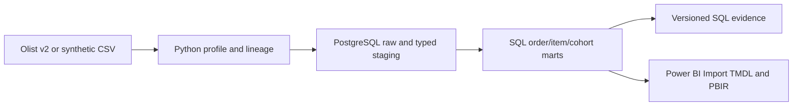

# RetailLens — B1

Marketplace analytics from official Olist CSVs to PostgreSQL and a four-page Power BI project.
Built on Jonatan Tomaszewicz's Python 3.12 template. Portfolio order: **B → C → D → A**.
Python handles ingestion/provenance; SQL owns analytical rules; Power BI consumes published marts
in Import mode. RetailLens compares delivered merchandise value, deliveries, reviews, payment
reconciliation and observed repeat purchases with explicit populations and exclusions.

## Actual verification

Full official **Olist version 2** has run on PostgreSQL 17.6. Reimport/rebuild preserve counts
and metrics. Accepted run `20261007T204100Z` executed **96 unit tests and 26 PostgreSQL tests**. Python
quality, PostgreSQL business tests, official Microsoft JSON
schemas and official TOM TMDL parsing have passed. Details: [PROJECT_STATE.json](docs/PROJECT_STATE.json).

Power BI Desktop **2.158.1304.0** opened and refreshed separate fresh real/synthetic projects.
All four native pages rendered in both modes; eight final screenshots and actual slicer
interactions are retained. The actual Desktop engine executed **32 required DAX queries**,
with **962 strict comparisons against PostgreSQL and no mismatches**, including the supplied
reconciliation queries and date/category/seller/empty selections.

**Final local acceptance: ACCEPTED / PASS; RL-08: CLOSED_ACCEPTED (2026-10-10).**
The accepted implementation is `cd8ad721933e0fa9c5e1636aa61a3a57e75cc237`,
with evidence run `20261009T2049086587846Z`. The review found no material defects.
The results below are historical accepted executions, not tests of the documentation
closure. **Local MVP: READY_ACCEPTED; container acceptance: PASS; REMOTE_CI: NOT_RUN.**
The overall `PARTIAL` state refers only to remote CI, outside the accepted local scope.
See [final acceptance](docs/FINAL_ACCEPTANCE.md) for the decision and evidence identity.
WTA keeps PostgreSQL5433 and dashboard8501. The preserved RetailLens Portable cluster
runs at **127.0.0.1:5435** because5434 was occupied too. Authenticated
`SHOW data_directory` identifies `output/postgres_data` before readiness, database
creation and every read-only capture connection. Credentials/data/KPIs remain unchanged.

Actual Linux Docker verification passed build/image ID, PostgreSQL health, synthetic and
full pinned Olist v2 demos, nine result sets/seven SQL queries per mode, negative-tolerance
exit1 and both cleanup phases. Its own host port was6433; containers stopped, named volumes
remain. WTA's container IDs, configuration hashes, ports and health stayed unchanged.
**77 scoped tests**, Ruff and the Windows PowerShell parser also passed.

Separate fresh real/synthetic Desktop projects opened and refreshed against5435.
TOM confirms provider/endpoint/model; six final ADOMD proof queries confirm all eight
imported table counts, source hashes and five main KPIs against current SQL.
Two real Overview screenshots are retained. The32queries/962comparisons and four-page
visual QA above are the historical model acceptance, not a new execution.
**REMOTE_CI: NOT_RUN**; no merge, push or publication occurred.
See [demo](docs/DEMO.md) and [PROJECT_STATE.json](docs/PROJECT_STATE.json).

## Run on Windows

Python 3.12 is required. From the project root:

```powershell
$env:DATABASE_PORT = '5435' # Current RetailLens endpoint; this shell only.
powershell -NoProfile -ExecutionPolicy Bypass -File scripts\setup.ps1 -Backend Portable
powershell -NoProfile -ExecutionPolicy Bypass -File scripts\demo.ps1 -Mode synthetic -Backend Portable
powershell -NoProfile -ExecutionPolicy Bypass -File scripts\demo.ps1 -Mode real -Backend Portable -ObservationEnd 2018-09-01
powershell -NoProfile -ExecutionPolicy Bypass -File scripts\open_powerbi.ps1 -Mode real
```

Setup creates a private `.env`, installs `requirements.lock`, then starts the selected backend.
The executed Windows path above uses isolated portable PostgreSQL at `127.0.0.1:5435`;
use `-Backend Docker` when a working daemon is available. Setup preserves credentials, other services
and volumes. Pass `-Python C:\path\to\python.exe` if needed. Windows portable binaries come
from EDB with pinned SHA256; the database stays in ignored `output/postgres_data`. Stop with
`.\.venv\Scripts\python.exe scripts\local_postgres.py stop`.
The per-process execution-policy argument supports Windows' default script restriction
without changing the user's global policy.

The real demo reuses or downloads `olistbr/brazilian-ecommerce/versions/2` to `data/raw/olist-v2`.
No Kaggle account was needed here. If access later requires consent/authentication, follow
[the official source instructions](docs/DATA_SOURCES.md). Existing nonempty inputs are not overwritten.

Opening Power BI validates and opens a new local copy in
`output/powerbi/<mode>/<UTC timestamp>-<unique suffix>/RetailLens.pbip`, preserving earlier sessions.
Pipeline and report use the same environment > `.env` > defaults connection settings. With an installed
Desktop, enable PBIP/PBIR features if requested, select Database authentication for PostgreSQL,
enter credentials from local `.env`, and refresh. No password is stored in TMDL. See
[POWER_BI.md](docs/POWER_BI.md) for the runtime checklist. `demo.ps1 -OpenReport` opens after import.

## Docker / Linux

On this Windows checkout, verify the complete container path with one command:

```powershell
powershell -NoProfile -ExecutionPolicy Bypass -File scripts\verify_docker.ps1
```

It creates a fresh evidence run, uses its own Compose project and a free port starting at6433,
and excludes the configured Portable port even when its listener is stopped. It validates Compose without printing credentials,
builds/records the exact app image used by synthetic and pinned Olist demos, compares all SQL
results with fresh read-only Portable references, checks the application-specific negative
tolerance error, and stops only its own containers in finally after both scenarios. Volumes
and previous results remain. Native failures retain their codes; exits0/1/2 mean PASS/FAIL/BLOCKED.
After a system reboot it can start the existing Portable cluster; it never initializes a new
cluster for this check. Source Olist is mounted read-only and is never downloaded by this scenario.

Docker Desktop4.93.0 and local Linux daemon29.8.1 were actually available in this run.
Historical missing-WSL failures remain in old evidence; no OS installation or feature
change was needed for the current verification.

Generate private credentials in `.env` from `.env.example`, then:

```bash
mkdir -p output data/raw
export DATABASE_PORT=6433 # Choose a free host port for this Compose backend.
# Allow container user 1000 to write output and data/raw using your local ownership policy.
docker compose up -d --wait db
docker compose run --rm app
docker compose run --rm app demo --mode real --observation-end 2018-09-01 --output /app/output/real
docker compose stop
```

`docker/Dockerfile` uses Python 3.12 and Compose uses PostgreSQL 17.6. Host clients connect to
the configured host port; app containers use `db:5432`. Change occupied `DATABASE_PORT` and prepare the
local report again. No command deletes volumes. Both backends were executed here.
Each backend has its own storage. Use a distinct free host port and backend configuration
for coexistence, or stop only your own Portable cluster if deliberately reusing its port.
The isolated verification command preserves Portable and WTA.

## CLI

Run `.\.venv\Scripts\python.exe -m retaillens <command>` (or installed `python -m retaillens`).
Warehouse commands accept `--mode real|synthetic`; modes have separate database schemas.

| Command | Behavior |
| --- | --- |
| `fixture` | Generate artificial CSVs in `data/sample` |
| `download --mode real` | Download pinned official Olist v2 |
| `profile --mode real --output output/profile` | Hashes, counts, nulls, validity, keys and months |
| `import --mode real --observation-end 2018-09-01` | Atomic raw/staging/mart publication and audit |
| `build --mode real` | Rebuild SQL marts, optionally with changed tolerance |
| `quality --mode real` | Model invariants, nonzero exit on failure |
| `analyse --mode real --output output/analysis` | Execute all analytical queries, export CSV/JSON |
| `export --mode real --output output/report_data/real` | Export marts for inspection |
| `demo --mode real --observation-end 2018-09-01` | Source, import, model, quality, analyses, exports |

Options: `--input`, `--version`, `--start`, `--end` (exclusive), `--observation-end`, `--tolerance`.
Money uses Decimal/NUMERIC; default tolerance is 0.01 BRL. Evidence records the model's actual
tolerance. Change the historical observation boundary by reimporting with the intended value.
Power BI connects to PostgreSQL rather than the CSV exports.

## Executed real results

Whole source: purchases **2016-09-04 through 2018-10-17**, all segments/statuses, 0.01 BRL
tolerance. Repeat follow-up assumes the **start of 2018-09-01**; sparse later rows do not prove
complete observation. First/last source months are flagged; no unsupported growth estimate is made.

| Metric | SQL result |
| --- | --- |
| Source orders | 99,441 |
| Delivered GMV | 13,221,498.11 BRL / 96,478 qualifying orders |
| Delivered AOV | 137.0415857501 BRL |
| On time | 88,587 / 95,097 = 93.1544%; 1,381 delivered exclusions |
| Delivered reconciliation | 96,178 matched; 299 mismatches; 1 not comparable |
| Observed repeat within 90 days | 1,519 / 75,703 = 2.0065%; 17,655 incomplete windows |

These are source-slice metrics, not profit, accounting revenue, churn or causal estimates.
The separate fixture gives **340.00 BRL GMV**, **6 eligible orders**, **3/5 on time**, **1/4 repeat**.
See [CASE_STUDY.md](docs/CASE_STUDY.md) for three evidence-linked findings.

## Verify and review

```powershell
powershell -NoProfile -ExecutionPolicy Bypass -File scripts\verify.ps1 -Postgres
powershell -NoProfile -ExecutionPolicy Bypass -File scripts\parse_tmdl.ps1 -Download
.\.venv\Scripts\python.exe scripts\validate_powerbi.py --postgres --mode real
```

PostgreSQL tests replace only `rl_synthetic`; run sequentially outside its demo. They check
exact financial outcomes, ambiguous CSV headers/reviews, unknown references, conflicting keys,
repeat boundaries, same-day delivery promises, audit/publication atomicity, rollback and schema
isolation. CI retains Ruff/pytest and adds PostgreSQL, official schemas and Docker/Compose
fixture checks without real Olist downloads on each PR. All Compose steps share the Docker job's
test configuration; CI checks cleanup after an intentionally failed demo and always stops services
while preserving volumes. Local Compose parsing and a remote container run are separate controls.

Run evidence, Polish review, patch, manifest, handoff and `REVIEW_BUNDLE.zip` are under
`output/codex_runs/<UTC_TIMESTAMP>`. Bundles omit secrets, environments, databases, full inputs,
Git and caches. Local MVP acceptance is closed on `feat/retaillens-mvp`. Remote CI remains
unexecuted; no merge, push or publication is part of the documentation closure.



Read [contract](docs/DATA_CONTRACT.md), [architecture](docs/ARCHITECTURE.md),
[demo](docs/DEMO.md), [plan](docs/PROJECT_PLAN.md), [template provenance](docs/TEMPLATE_ADAPTATION.md)
and [contribution rules](CONTRIBUTING.md).

Code/artificial fixtures: MIT, author **Jonatan Tomaszewicz**. Olist inputs and derived evidence
retain [CC BY-NC-SA 4.0 terms](https://www.kaggle.com/datasets/olistbr/brazilian-ecommerce).
Microsoft schema attribution is retained separately. Local container acceptance is complete;
remote CI remains unexecuted. Future analytical work includes source completeness
agreement, incremental snapshots and investigation of mismatches.
