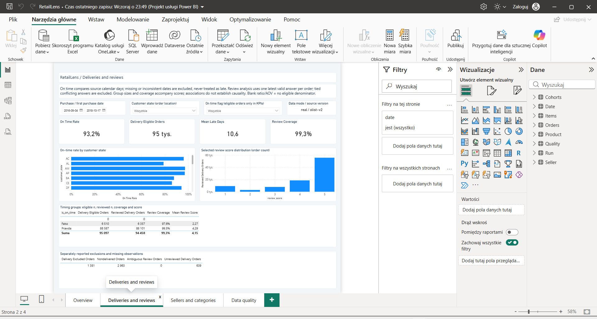
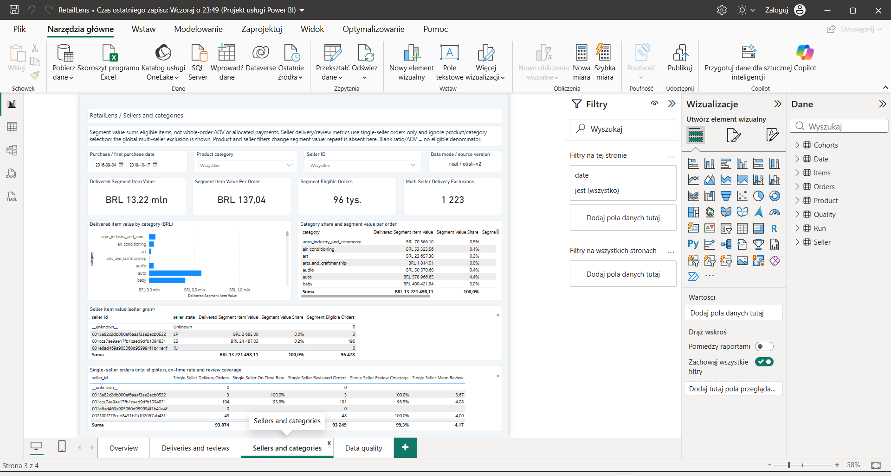
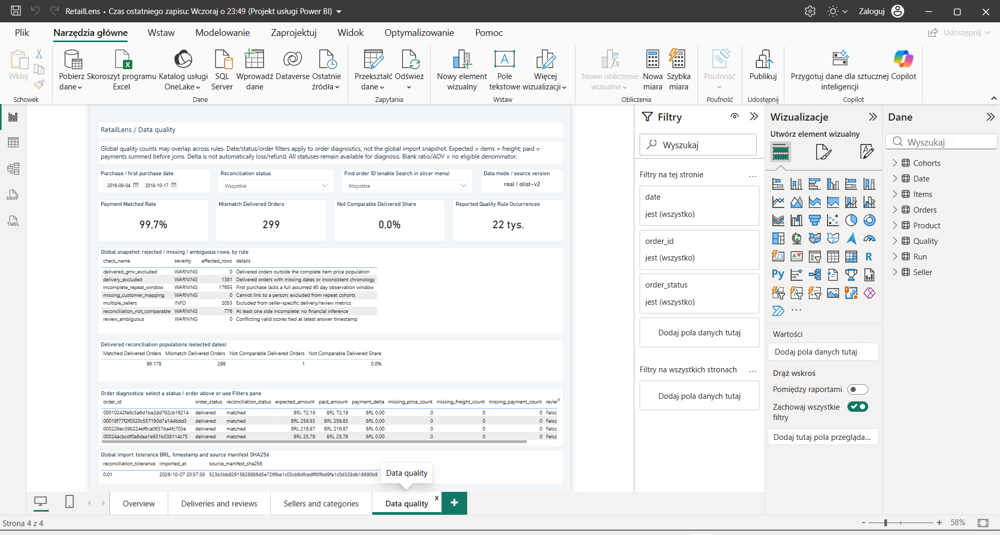

# RetailLens: trustworthy marketplace metrics

Joining raw items, payments and reviews can multiply money; missing dates and
incomplete follow-up change denominators. RetailLens lets a marketplace analyst
review delivery, payment and repeat-purchase signals with explicit populations,
from official Olist to PostgreSQL and a four-page Power BI report.

## Study scope and evidence

Official **Olist v2**, **real mode**, **99,441 orders**, purchases
**2016-09-04–2018-10-17**. Queries use `[2016-09-04, 2018-10-18)` and a
**0.01 BRL** per-order reconciliation tolerance. Repeat follow-up assumes the
start of **2018-09-01**. September has 16 and October 4 source orders, none delivered;
the sparse tail is excluded from follow-up, but the cutoff does not certify
source completeness.

The [small real evidence set](evidence/real/README.md) copies previously executed
aggregate outputs from accepted run `20261007T204100Z`. Its
[provenance](evidence/real/provenance.json), [source manifest](evidence/real/source_manifest.json)
and [run parameters](evidence/real/run_metadata.csv) keep source identity and hashes
available through relative repository links. No queries were rerun to prepare this page.
Code is MIT; Olist and collaborators' data/derived material retains the recorded
**CC BY-NC-SA 4.0** attribution in [data sources](DATA_SOURCES.md).

## Three supported findings

1. **Observed reviews differ between delivery groups.** 88,587 eligible on-time
   orders have 88,101 reviews, mean 4.28984; 6,510 late orders have 6,357 reviews,
   mean 2.26915. Coverage is 99.45% vs 97.65%; 1,381 delivered orders lack valid
   date/chronology eligibility. [SQL by state/group](../sql/05_deliveries_reviews.sql),
   [state-level output](evidence/real/05_deliveries_reviews.csv) and the
   [independent grouped control](evidence/real/sql_evidence.json) support the
   comparison; [control implementation](../scripts/check_real_run.py) is available.
   Investigate late-delivery segments and communications. This is association,
   not evidence that an intervention causes the score difference.

2. **A small comparable delivered population needs financial investigation.**
   96,178 orders match; 299 exceed the one-cent tolerance;one is incomparable.
   Mismatches total **+2,832.14 BRL paid-minus-expected**, about 0.310% of
   comparable delivered orders. [SQL](../sql/07_reconciliation.sql) and
   [saved status/group totals](evidence/real/07_reconciliation.csv) include all
   statuses; this finding selects **delivered** only. Inspect order/source records
   before inferring refunds, losses or allocations. Tolerance applies per order;
   matched deltas need not sum to zero.

3. **Observed repeat is low under the chosen historical window.**
   **1,519/75,703 eligible people (2.00653%)** repeat within 90 days;
   **17,655** incomplete windows are excluded. [SQL](../sql/08_repeat.sql)
   and [saved output](evidence/real/08_repeat.csv) support the result.
   This suggests a future controlled repeat-purchase experiment, not a churn or
   CLV estimate. First observed is not necessarily first-ever purchase;
   255 simultaneous first-timestamp orders are not later repeats.
   Seller/category filters do not change this person-cohort metric.

## Actual report pages

All images show **real / olist-v2**, full purchase dates and default/all page filters.
They are unedited copies of accepted Desktop captures, with hashes/runs recorded in
[image provenance](images/README.md). [Overview](../README.md) is embedded at the repository entry.

### Deliveries and reviews

The eligible denominator and group sizes accompany on-time rates and review scores.

### Sellers and categories

Category/seller item value uses item grain. Seller delivery/review attribution
uses single-seller orders; segment selection does not redefine person cohorts.

### Data quality

Per-order diagnostics and delivered reconciliation have a different scope from
global, potentially overlapping quality-rule occurrences.

## Engineering decisions and accepted verification

Money is Decimal/NUMERIC; independent facts aggregate before joining, without
`SUM(DISTINCT)`. Whole-order delivered GMV is **13,221,498.11 BRL** over
**96,478** orders; AOV is 137.04159 BRL.
[Overview SQL](../sql/03_overview.sql) and [output](evidence/real/03_overview.csv)
provide the exact source-slice values. Latest valid review wins; conflicting latest
scores are excluded with raw rows retained.

Separate real/fixture schemas keep artificial tests out of business findings.
A database transaction publishes raw/staging/marts together. Reimport/rebuild
preserve results. SQL owns KPI definitions; Python orchestrates/profiles and
Power BI consumes published marts. The [contract](DATA_CONTRACT.md) and
[architecture](ARCHITECTURE.md) define financial, seller and observation boundaries.

Accepted historical model verification in `20261007T204100Z` includes 96 unit tests,
26 PostgreSQL tests, official schema/TOM checks, Desktop refresh, all four rendered
pages and 32 DAX queries with 962 strict SQL comparisons. The RL-08 run
`20261009T2049086587846Z` includes actual local Docker build, full Olist v2 and
fixture demos, 14 gates, negative tolerance and both cleanup paths; all passed.
Fresh real/synthetic Desktop projects then refreshed on the configured Portable
endpoint **127.0.0.1:5435**, with 8 tables and 5 KPI proofs per mode.

**Local MVP and Docker: ACCEPTED / PASS; RL-01–RL-08: CLOSED_ACCEPTED.**
**REMOTE_CI: PASS** — all four required Actions jobs completed successfully.
[Publication record](PUBLICATION.md) links the exact verified SHA and run.
[Final local acceptance](FINAL_ACCEPTANCE.md) and [PROJECT_STATE.json](PROJECT_STATE.json)
preserve the historical accepted commits/runs separately. Remote CI runs the fixture;
the real-study results and Desktop captures above remain the accepted local evidence.

Follow the [three-minute presentation and publication guide](PRESENTATION.md).
